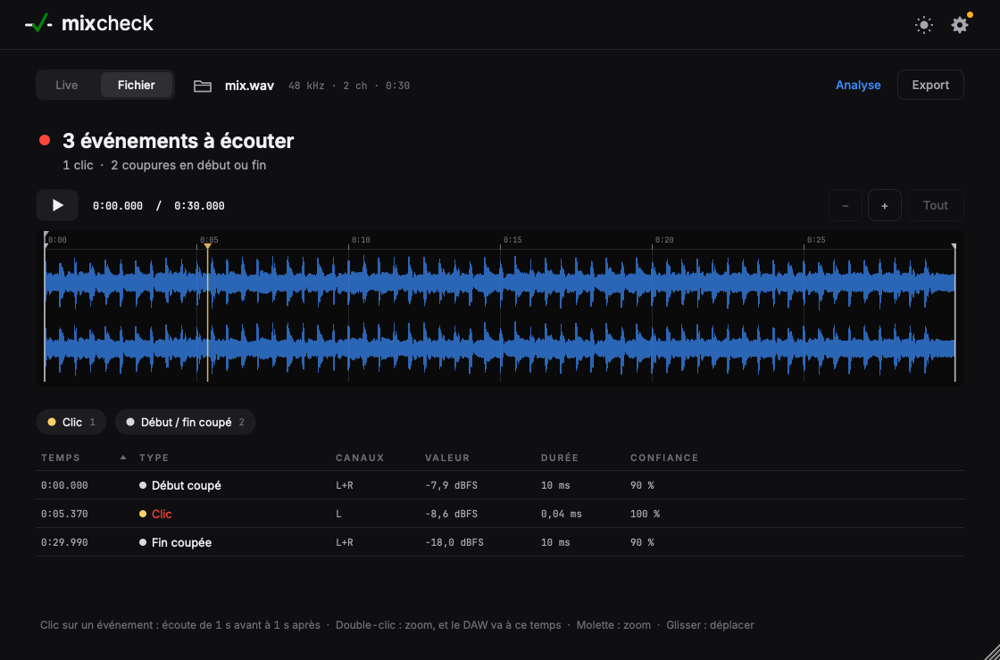
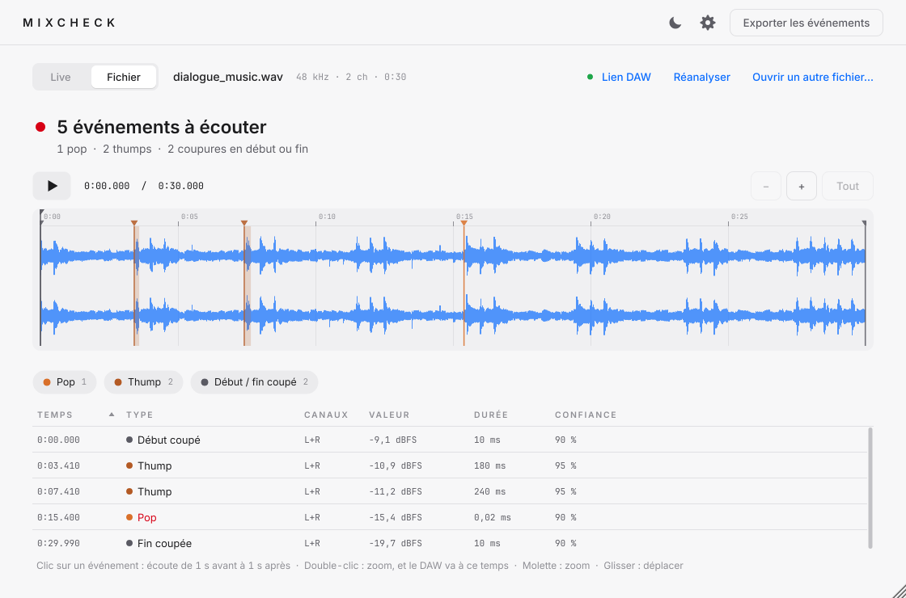
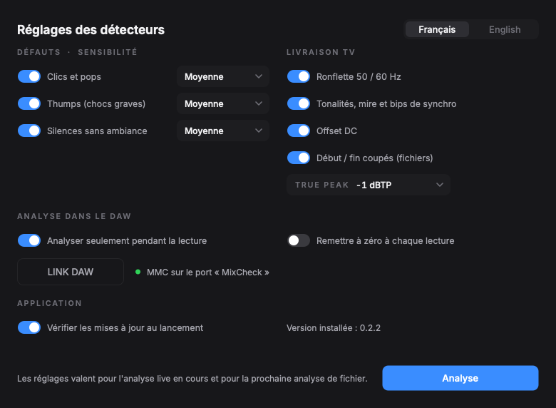
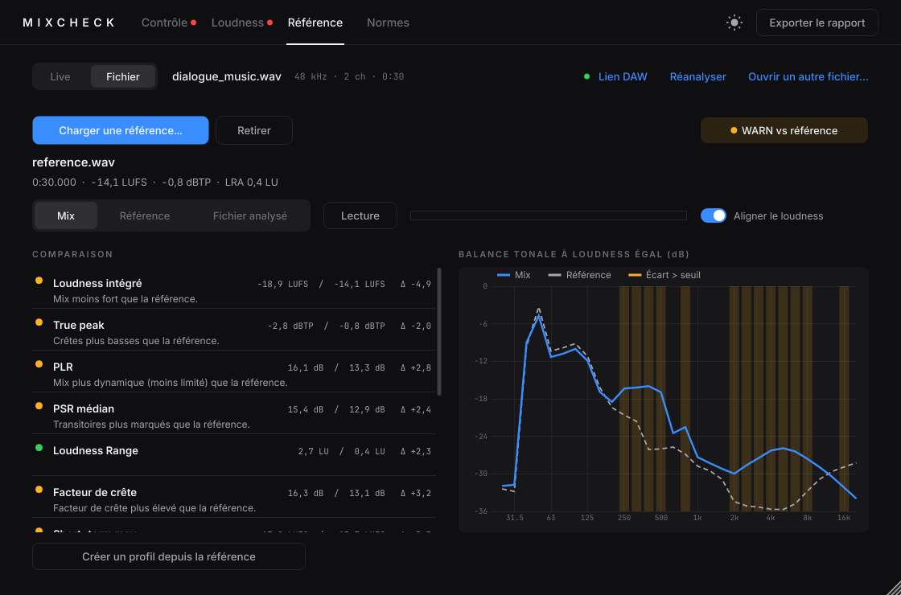
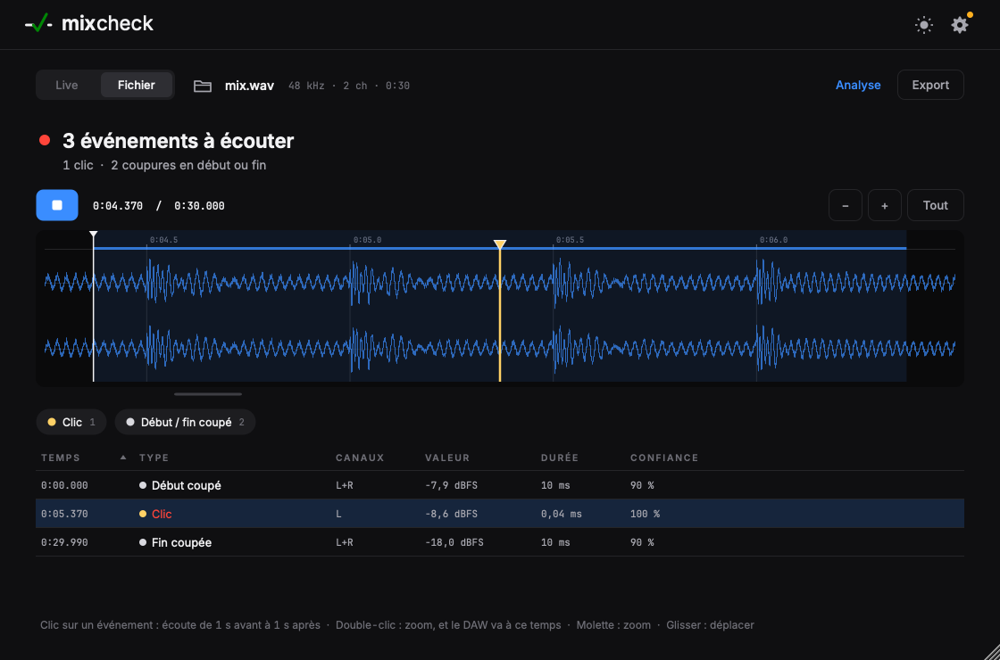
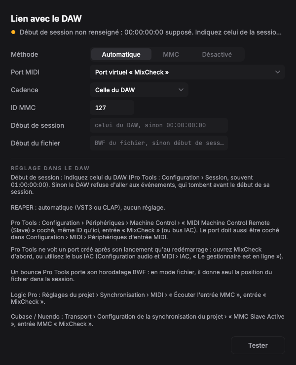

# MixCheck

**Validation de mix avant livraison** : clics, pops, thumps, silences sans ambiance, ronflette, crêtes et écrêtage, problèmes de phase, et conformité loudness / dynamique aux normes du streaming, du broadcast et des plateformes vidéo. Vous pouvez aussi comparer le mix à un fichier de référence (normes et référence masquées dans l'interface pendant la bêta : voir *Ce que MixCheck vérifie*).

Ce dépôt contient seulement les **versions publiées** (pas le code source) : voir *Télécharger* ci-dessous.

MixCheck existe sous trois formes, toutes construites sur le même moteur d'analyse :

| Forme | Usage |
|---|---|
| **Plugin** VST3 · AU · CLAP | Inséré sur le bus master du DAW : analyse pendant la lecture ou pendant l'export hors ligne. Les événements sont positionnés sur la timeline du DAW. |
| **Application** autonome (macOS, Windows) | Même interface que le plugin. Elle analyse un fichier audio, ou une entrée audio (carte son). |
| **`mixcheck-cli`** | Analyse en ligne de commande, rapports JSON / HTML et code de sortie pour les scripts de livraison ou la CI. |



## Télécharger

👉 **[Dernière version](../../releases/latest)** (page *Releases*, à droite) : actuellement **0.2.2**.

| Système | Fichier | Contenu |
|---|---|---|
| macOS (Apple Silicon et Intel) | `MixCheck-<version>-macOS.dmg` | Application, plug-ins AU, VST3, CLAP |
| Windows | `MixCheck-<version>-Windows.zip` | Application, plug-ins VST3 et CLAP, outil en ligne de commande (pas encore publié pour la 0.2.x) |

Chaque version est accompagnée de l'empreinte **SHA-256** du DMG (fichier `.sha256`), pour vérifier que le téléchargement est intact. Cette vérification est facultative :
```bash
shasum -a 256 ~/Downloads/MixCheck-<version>-macOS.dmg
```

## Installer

### macOS
1. Ouvrez le DMG et glissez **MixCheck.app** dans **Applications**.
2. Double-cliquez sur **« Installer les plug-ins.command »** : il copie les plug-ins AU, VST3 et CLAP dans `~/Library/Audio/Plug-Ins`.
3. Relancez le DAW. Les plug-ins se trouvent chez le fabricant **MixCheck**.

L'application et les plug-ins sont **signés et notarisés par Apple** : macOS les ouvre normalement, après un simple message de confirmation au premier lancement.

### Windows
1. Décompressez le zip.
2. Copiez **MixCheck.vst3** dans `C:\Program Files\Common Files\VST3` et **MixCheck.clap** dans `C:\Program Files\Common Files\CLAP`.
3. L'application autonome est **MixCheck.exe**.

## Bêta

Pendant la bêta, MixCheck est **gratuit et entièrement débloqué**, sans limite de temps, sans compte ni activation.

## Mises à jour

À partir de la version 0.2.2, au lancement, MixCheck vérifie s'il existe une version plus récente sur ce dépôt. Si c'est le cas, un bouton **« Mise à jour x.y.z »** apparaît en haut à droite. **Télécharger** ouvre la page de la version. **Ignorer cette version** masque le bouton jusqu'à la suivante. Vous pouvez désactiver cette vérification dans les **Réglages** (roue crantée), avec l'option **Vérifier les mises à jour au lancement**. Aucune donnée n'est envoyée : MixCheck lit seulement le numéro de la dernière version.

## L'interface

Pour l'instant, une seule page : **les événements à écouter**. Les onglets Loudness, Référence et Normes sont masqués dans cette version.

- Leur nombre par type, la timeline du fichier, **zoomable**, avec un bouton **lecture / stop**, des filtres par type et la liste.
- Sélectionner un événement l'écoute **de 1 s avant à 1 s après**, puis la lecture s'arrête seule.
- **Réglages** (roue crantée, en haut à droite) : activation et sensibilité de chaque détecteur, seuil true peak (-1, -2 ou -3 dBTP), analyse dans le DAW et **LINK DAW** (lien avec la timeline du DAW). **Analyse** applique les réglages au fichier affiché. **Français / English** (en haut à droite des Réglages) choisit la langue de l'interface, des exports et des marqueurs : le choix est enregistré et s'applique tout de suite (par défaut, la langue du système). **Vérifier les mises à jour au lancement** active ou coupe la notification de nouvelle version ; la **version installée** y est affichée.

- **Thème sombre ou clair** : bouton lune / soleil en haut à droite. Le choix est mémorisé ; au premier lancement, MixCheck suit le thème du système.
- **Export** (à droite de la ligne du fichier, à côté de **Analyse**) : CSV, marqueurs MIDI, Reaper ou Audacity, ou **marqueurs dans le fichier pour iZotope RX** (voir plus bas).
- **Mise à jour x.y.z** (en haut à droite) : apparaît quand une version plus récente est publiée (voir *Mises à jour*).
- Polices **Inter** et **JetBrains Mono**, embarquées.





## Ce que MixCheck vérifie

**Défauts audio**
- **Clics** : impulsions de moins de 2 ms (coupe sans fondu, dépassement CPU, erreur numérique).
- **Pops** : discontinuités de 2 à 20 ms et sauts de niveau (DC).
- **Thumps** : bouffées graves isolées (chocs sur un pied de micro, plosives). Un kick régulier n'est pas signalé.
- **Écrêtage** : 3 échantillons consécutifs à pleine échelle, ou plus.
- **Plateaux** : mix écrêté puis baissé, qu'un simple crête-mètre ne voit pas.
- **Offset DC.**

**Silences sans ambiance** (dialogue)
- **Silence numérique** : le son tombe à zéro au milieu du programme, typiquement un trou de montage sans ambiance de comblement. Le silence de tête et de fin est normal et n'est pas signalé.
- **Trou d'ambiance** : le fond sonore chute nettement sous l'ambiance mesurée autour, sans aller jusqu'au zéro. Causes typiques : raccord sans ambiance, gate ou débruitage trop agressif.
- Niveau d'ambiance estimé, en dBFS.

**Livraison TV** (contrôles courants des QC broadcast : EBU QC, Netflix, diffuseurs)
- **Ronflette** : raie stable à 50 ou 60 Hz, ou à leurs harmoniques (100, 150, 120, 180 Hz), pendant au moins 6 s, au-dessus de -80 dBFS. Une note de musique tenue n'est pas prise pour le secteur.
- **Tonalité / bip** : sinus pur tenu au moins 1 s au-dessus de 300 Hz (mire 1 kHz, 400 Hz, sifflement, larsen), ou **bip de synchro** (2-pop : 1 kHz pendant une image) isolé dans le silence.
- **Offset DC** : composante continue au-dessus de -40 dBFS pendant au moins 2 s, canal par canal.
- **Début / fin coupés** (fichiers) : le fichier commence ou finit en plein signal, sans silence ni fondu.

Pendant la bêta, l'interface n'affiche que **les événements** (défauts audio, silences, crêtes, phase). Les mesures, les normes et la référence décrites plus bas sont masquées dans l'interface et reviendront dans une prochaine version ; en attendant, seule la ligne de commande `mixcheck-cli` les produit (rapports HTML / JSON).

**Crêtes**
- True peak (ITU-R BS.1770-4, suréchantillonnage ×4).
- Crête échantillon.
- Dépassements horodatés.

**Loudness et dynamique** (onglet Loudness, masqué pendant la bêta)
- Mesures EBU R128 : intégré (gating), momentary, short-term, Loudness Range (EBU Tech 3342).
- **Loudness dialogue** : loudness mesuré uniquement pendant la parole, comme le demandent Netflix et Disney+. La parole est repérée par un détecteur intégré. Le pourcentage de parole est affiché, et les zones détectées apparaissent en vert sur l'historique pour vérification.
- PLR, PSR médian, facteur de crête.

**Phase et stéréo** : les passages hors phase et les inversions de polarité sont signalés comme événements ; corrélation, goniomètre et compatibilité mono sont dans l'onglet Loudness, masqué pendant la bêta.
- Corrélation globale et par bande (graves, médiums, aigus), et goniomètre.
- Compatibilité mono : perte de loudness en repli mono.
- Inversion de polarité, passages hors phase, retard entre L et R, balance, largeur.

**Normes** (onglet masqué pendant la bêta) : chaque critère reçoit un statut PASS / WARN / FAIL, avec explication.
- Streaming : Spotify, Apple Music, YouTube, Tidal, Amazon Music, Deezer, SoundCloud, podcasts.
- Broadcast : EBU R128, R128 s1, ATSC A/85, ARIB TR-B32, OP-59.
- Vidéo : Netflix, Amazon Prime Video, Disney+.
- **Profils personnalisés**, éditables dans l'interface.

**Référence** (onglet masqué pendant la bêta) : chargez un master du commerce ou une version validée (WAV, AIFF, FLAC…) :
- comparaison des loudness, PLR, LRA et largeur stéréo ;
- **balance tonale à loudness égal**, par bandes de 1/3 d'octave ;
- **écoute alignée en loudness** : Mix, Référence ou Fichier analysé ;
- création d'un profil de conformité à partir de la référence.



**Exports** (bouton **Export**)
- Rapports : HTML lisible, JSON complet (pendant la bêta, avec `mixcheck-cli` seulement : ils ne figurent plus dans le menu **Export**).
- Liste d'événements en CSV.
- Marqueurs pour le DAW : **fichier MIDI** (Pro Tools, Logic, Cubase…), **CSV Reaper**, **labels Audacity**.
- **Marqueurs dans le fichier (iZotope RX)** : voir ci-dessous.

### Marqueurs pour iZotope RX
En mode Fichier, **Export › Marqueurs dans le fichier (iZotope RX)…** ouvre une fenêtre où l'on coche les **types d'événements** à marquer (au départ : ceux affichés par les filtres). Chaque événement devient un marqueur inscrit dans le WAV (chunks `cue` et `adtl`, lus par iZotope RX, WaveLab, Sound Forge, Audition) ; les défauts d'au moins 0,1 s deviennent des **régions**. Le nom du marqueur reprend la description de l'événement (« Clic (L) -8,6 dBFS »), en ASCII pour s'afficher partout.

- **Écrire dans le fichier** : ajoute les marqueurs au fichier analysé. L'audio et les autres métadonnées (horodatage BWF, iXML…) sont recopiés à l'identique ; les marqueurs déjà présents sont remplacés.
- **Enregistrer une copie…** : écrit un nouveau WAV, l'original reste intact. Un fichier AIFF, FLAC ou MP3 est converti en WAV (24 bits, ou 32 bits flottants).
- Limite : WAV de moins de 4 Go (les fichiers RF64 ne sont pas pris en charge).

- **Ouvrir automatiquement dans RX** (case à côté de **Enregistrer une copie…**) : une fois les marqueurs écrits (dans le fichier ou dans la copie), le fichier s'ouvre directement dans RX. Le choix est enregistré et retrouvé aux ouvertures suivantes. MixCheck lance la version la plus récente installée (macOS : `/Applications/iZotope RX … Audio Editor.app` ; Windows : `Program Files\iZotope\…`) ; **Choisir… / Changer…** désigne une autre application.

Dans RX, les marqueurs apparaissent sur la timeline et dans la fenêtre *Markers & Regions*. Si le fichier y est déjà ouvert, fermez-le d'abord pour relire les nouveaux marqueurs.

## Utilisation

### Dans le DAW
1. Insérez **MixCheck** en dernier sur le bus master.
2. Lancez la lecture, ou un **export hors ligne** : le plugin attend l'analyse, aucun échantillon n'est perdu.
3. La page liste les événements détectés, positionnés sur la timeline du DAW : **un double-clic sur un événement place la tête de lecture du DAW sur ce temps** (voir *Lien avec le DAW*).

Les résultats, le profil et la référence sont enregistrés avec le projet.

### Application autonome
- **Live** analyse l'entrée audio choisie dans les options de l'application. Un **vumètre d'entrée** (crête par canal et loudness momentary) montre que le signal arrive.
- **Analyser la sortie du DAW** : le plus simple est le **plugin** inséré en dernier sur le bus master (les événements sont alors placés sur la timeline du DAW). Avec l'application, il faut une carte son virtuelle (BlackHole, Loopback…) : sortie du DAW vers ce périphérique, entrée de MixCheck sur ce même périphérique.
- L'entrée n'est jamais renvoyée vers la sortie : pas de larsen avec un micro. La sortie ne sert qu'à l'écoute du fichier.
- Au lancement, l'application s'ouvre sur l'onglet **Fichier, sans fichier chargé** : seuls les réglages (détecteurs, thème, langue) sont conservés d'une session à l'autre.

### Analyser un fichier (plugin ou application)
Choisissez **Fichier**, puis l'icône **dossier** (à gauche du nom du fichier), ou **glissez-déposez** un fichier audio n'importe où sur la fenêtre, quel que soit le mode affiché : un cadre « Déposez le fichier pour l'analyser » apparaît pendant le glisser.

En mode fichier, la page affiche la forme d'onde du fichier avec les événements :

- **Sélectionner un événement** (clic dans la liste, flèches du clavier, clic sur son marqueur) l'écoute **de 1 s avant son début à 1 s après sa fin**, puis la lecture s'arrête seule. L'extrait écouté est surligné sur la timeline.
- **Lecture / stop** : le bouton ▶ / ■, ou la barre d'espace. Un clic sur la forme d'onde lance la lecture depuis ce point.
- **Zoom** : molette ou pincement sur la forme d'onde (autour du pointeur), boutons **−**, **+** et **Tout**. Un double-clic sur un événement cadre son extrait. Au zoom fort, la forme d'onde est relue dans le fichier jusqu'à l'échantillon, ce qui rend visibles les clics les plus courts.
- **Se déplacer** : glisser la forme d'onde, Maj + molette, défilement horizontal du pavé tactile ou barre de défilement. En lecture, la vue suit la tête de lecture.

Un double-clic sur un événement envoie aussi le DAW à cet endroit. Le début du fichier dans la session est pris dans son **horodatage BWF** (écrit par Pro Tools à chaque bounce) ; sans horodatage, le fichier est supposé commencer au début de la session, sinon réglez « Début du fichier » dans **LINK DAW**. Dans le DAW, le fichier ne remplace la sortie du plugin que pendant son écoute : dès qu'elle s'arrête, le mix repasse de lui-même.



### Lien avec le DAW
Le bouton **LINK DAW**, dans les **Réglages** (roue crantée), ouvre les réglages du lien ; son état est affiché à côté (pastille verte : prêt).

| DAW | Fonctionnement | Réglage |
|---|---|---|
| **REAPER** (VST3, CLAP) | API de REAPER : la tête de lecture va exactement au temps | Aucun |
| **Pro Tools** | Commande MIDI Machine Control « Locate » sur le port MIDI virtuel « MixCheck » (ou un bus IAC) | Configuration › Périphériques › Machine Control › « MIDI Machine Control Remote (Slave) » coché, même ID que dans **LINK DAW** (127 par défaut), entrée « MixCheck ». Le port doit aussi être coché dans Configuration › MIDI › Périphériques d'entrée MIDI |
| **Logic Pro** | Idem | Réglages du projet › Synchronisation › MIDI › « Écouter l'entrée MMC », entrée « MixCheck » |
| **Cubase / Nuendo** | Idem | Configuration de la synchronisation du projet › « MMC Slave Active », entrée MMC « MixCheck » |
| Studio One, Ableton Live | Pas de MMC Locate : le temps est copié dans le presse-papiers | — |

- Le port virtuel « MixCheck » existe tant que MixCheck est ouvert (macOS, Linux). Sous Windows, il n'y a pas de port virtuel : créez-en un avec loopMIDI et choisissez-le dans **LINK DAW**.
- Le timecode envoyé tient compte du **début de session** (par exemple 01:00:00:00 dans Pro Tools) et de la **cadence** donnés par le DAW. Logic ne les transmet pas au plugin : réglez-les dans **LINK DAW** si la session ne démarre pas à 00:00:00:00.
- Le bouton **Tester** envoie le DAW au premier événement.

**Pro Tools : si la tête de lecture ne bouge pas**
1. **Début de session (cause la plus fréquente).** Pro Tools ne va pas avant le début de la session ; une pastille ambre sur la roue des Réglages signale qu'il n'est pas renseigné. L'application autonome ne connaît pas celui de Pro Tools : réglez « Début de session » (souvent 01:00:00:00 en TV) dans **LINK DAW**, ou analysez un bounce horodaté (BWF), qui donne seul la bonne position.
2. **Port MIDI.** Pro Tools ne voit un port créé après son lancement qu'à son redémarrage : ouvrez MixCheck avant Pro Tools, ou passez par le bus IAC (Configuration audio et MIDI › Studio MIDI › Gestionnaire IAC › « Le gestionnaire est en ligne ») et choisissez-le des deux côtés. Vérifiez qu'il est coché dans les périphériques d'entrée MIDI de Pro Tools.
3. **ID MMC.** Pro Tools ne répond qu'à son ID de Machine Control, ou à 127 (tous). En cas de doute, mettez le même ID des deux côtés.
4. **Cadence.** Sans information du DAW, MixCheck envoie du 25 i/s ; réglez « Cadence » si la session est en 23,976, 24 ou 29,97.



### Ligne de commande
`mixcheck-cli` est fourni avec le zip Windows, ou à compiler ; il n'est pas dans le DMG macOS.

```bash
mixcheck-cli mix.wav -p spotify,ebu-r128 -r reference.wav --html rapport.html --json rapport.json --midi marqueurs.mid
```
```bash
mixcheck-cli mix.wav --wav-markers mix-marqueurs.wav --marker-types click,pop,clipping
```
```bash
mixcheck-cli --list-profiles
```
Codes de sortie : `0` conforme ou avertissements, `2` non conforme (selon le premier profil), `1` erreur.

## Limites connues
- **Loudness dialogue** : c'est une approximation de Dolby Dialogue Intelligence, l'outil propriétaire utilisé par Netflix et Disney+. Sur nos tests de parole française synthétique, l'écart est de 0,1 à 0,8 LU. Le chant peut être compté comme parole, et une voix très traitée ou noyée peut être sous-détectée.
- **Langue** : les noms des paramètres vus par le DAW (automation) prennent la langue choisie au chargement du plugin ; après un changement, ils suivent au prochain chargement. Les messages des normes et le rapport HTML (masqués dans cette version) restent en français, comme la ligne de commande.
- Les détecteurs de défauts sont des **heuristiques**. Chaque événement porte un indice de confiance et doit être confirmé à l'écoute. Trois réglages de sensibilité existent : Basse, Moyenne, Haute.
- **Windows** : pas encore de zip publié pour la 0.2.x.
- Les valeurs des normes évoluent. Vérifiez le cahier des charges de votre diffuseur. Les profils intégrés indiquent leur source et leur date.

## Signaler un problème

Ouvrez une [issue](../../issues) en indiquant :
- la version de MixCheck (dans les Réglages : « Version installée ») ;
- le système (macOS ou Windows et sa version), le DAW, ou l'application autonome ;
- ce que vous avez fait, ce que vous attendiez et ce qui s'est passé ;
- si possible, une capture d'écran ou un court extrait audio.
